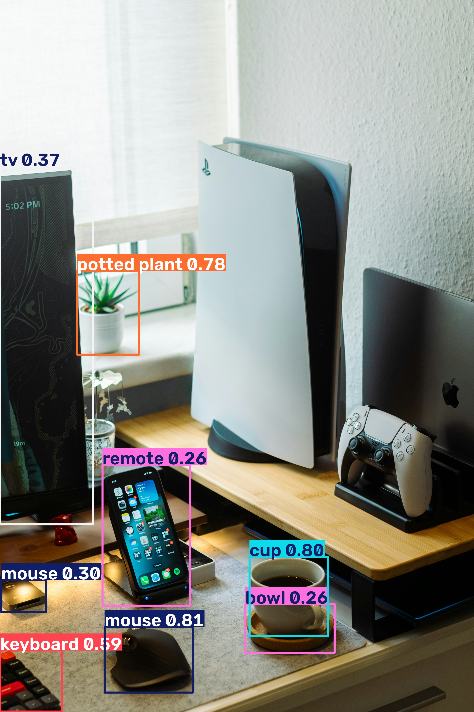
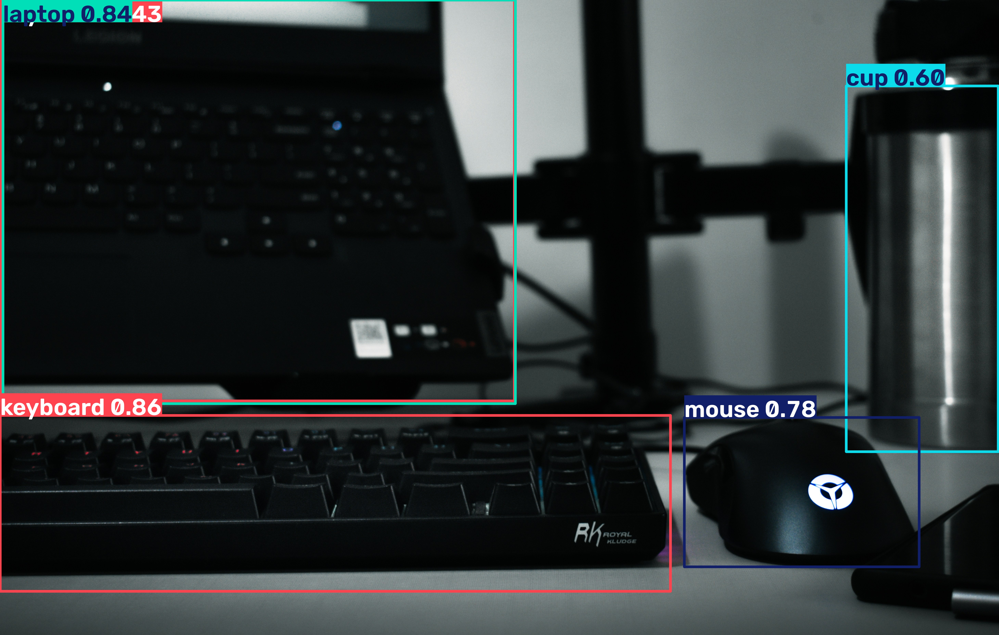
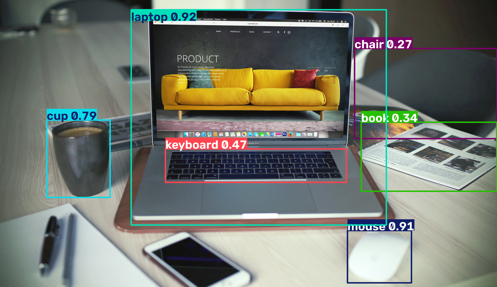
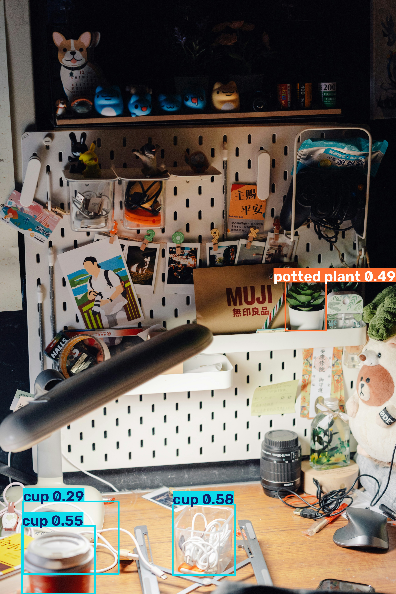
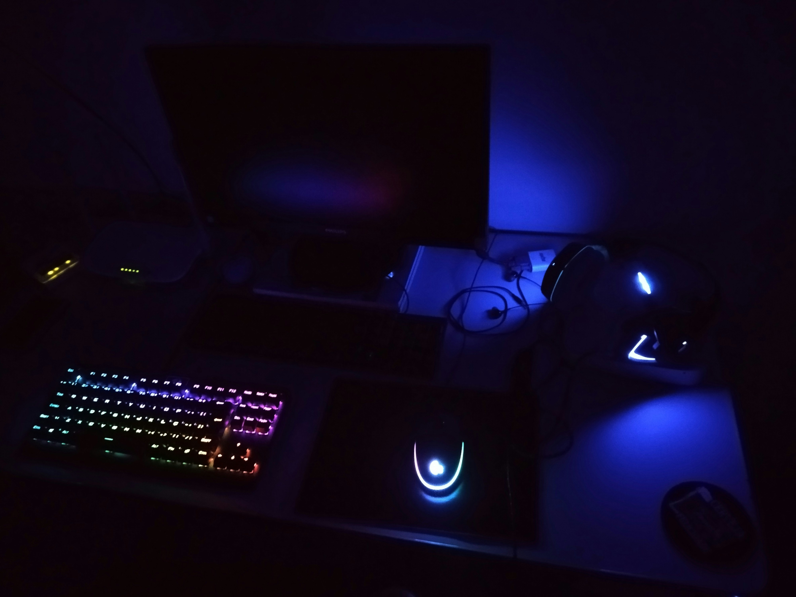

# YOLOv8n ile Gerçek Zamanlı Nesne Tespiti (Object Detection)

Bu proje, günlük yaşam nesnelerini (bardak, cep telefonu, klavye, mouse, şişe, kitap, laptop vb.) gerçek dünya fotoğrafları üzerinde yüksek doğruluk ve düşük gecikmeyle tespit etmek amacıyla **Ultralytics YOLOv8n** mimarisi ve **COCO128** veri seti kullanılarak uçtan uca geliştirilmiş bir Bilgisayarlı Görü (Computer Vision) ve MLOps uygulamasıdır.

---

## 📊 Proje Özeti ve Akademik Rapor Tablosu

| Kriter | Değer / Detay |
| :--- | :--- |
| **Project Title** | YOLOv8n ile Gerçek Zamanlı Günlük Yaşam Nesne Tespiti |
| **Problem / Task** | Nesne Tespiti (Multi-Class Object Detection — 80 COCO Sınıfı) |
| **Dataset** | COCO128 — Toplam **128** görüntü (**Train:** 89 [%70], **Validation:** 19 [%15], **Test:** 20 [%15], `seed=42`) |
| **Dataset URL** | https://ultralytics.com/assets/coco128.zip |
| **Model Architecture** | Ultralytics YOLOv8n (`yolov8n.pt`, Pretrained Transfer Learning, 3.15M parametre, 8.7 GFLOPs) |
| **Input Size** | 640 × 640 × 3 (RGB) |
| **Hyperparameters** | `epochs=25`, `batch=16`, `imgsz=640`, `lr0=0.001`, `weight_decay=0.0005`, `workers=2`, `seed=42` |
| **Optimizer** | AdamW (`lr0=0.001`, `weight_decay=0.0005`) |
| **Activation / Output Function** | Hidden: SiLU, Output: Sigmoid + Linear Bounding Box Regression |
| **Loss Function** | Box Loss: CIoU, Class Loss: BCEWithLogitsLoss, DFL: Distribution Focal Loss |
| **Evaluation Metrics** | mAP@50, mAP@50-95, Precision, Recall, F1-Score, Ortalama IoU, Inference Time (ms/image) |
| **Training Environment** | Windows 11, Intel Core i5-12500H, NVIDIA GeForce RTX 3050 Ti (4GB VRAM), 16GB RAM, PyTorch `2.14.1+cu126` (CUDA) |
| **Best Performance** | **mAP@50:** `0.7403` \| **mAP@50-95:** `0.5859` \| **Precision:** `0.6226` \| **Recall:** `0.6775` \| **F1-Score:** `0.6489` \| **Ortalama IoU:** `0.7827` (Eğitim Süresi: `173.09 sn` / `2.88 dk`) |
| **Inference Time** | `31.67 ms/image` (Hiç görülmemiş Test kümesi üzerinde tekil görüntü ortalaması) |
| **Deployment Technology** | Streamlit (`app.py`), Ultralytics YOLOv8, OpenCV, Pillow, Pandas |
| **Repository** | https://github.com/batuhanbas1/CV-Deep-Learning-Project |

---

## 🧠 Hiperparametre ve Loss Seçimlerinin Teknik Gerekçeleri

### 1. Model ve Transfer Öğrenme (`yolov8n.pt`)
- **YOLOv8 Nano (`yolov8n`)**, 3.15M parametre ve 8.7 GFLOPs ile **4GB VRAM (RTX 3050 Ti)** sınırına takılmadan `640×640` çözünürlükte `batch=16` ile akıcı eğitim ve gerçek zamanlı çıkarım (inference) sağlar.
- COCO üzerinde önceden eğitilmiş ağırlıklarla başlanması (Transfer Learning), 128 görüntülük küçük veri setinde aşırı öğrenmeyi (overfitting) azaltır ve hızlı yakınsama (convergence) sunar.

### 2. Optimizer ve Hiperparametreler
- **`AdamW` (`lr0=0.001`, `weight_decay=0.0005`):** Ağırlık azaltmayı (weight decay) gradyan güncellemesinden ayırarak (decoupled weight decay) küçük veri setlerinde genelleme kapasitesini artırır ve `lr0=0.001` ile kararlı bir öğrenme eğrisi sağlar.
- **`batch=16`, `imgsz=640`, `workers=2`:** 4GB VRAM bellek bütçesi içinde OOM (Out-of-Memory) hatası almadan maksimum GPU verimliliği hedeflenmiştir.
- **`epochs=25`:** Transfer öğrenme ile 25 epoch, doğrulama kaybının dengelenmesi ve sınırlı veri üzerinde aşırı ezberlemeden kaçınılması için ideal bir denge noktasıdır.

### 3. Kayıp Fonksiyonları (Loss Functions)
- **Box Loss — CIoU (Complete IoU):** Sadece kesişim/birleşim oranını (IoU) değil; merkez noktalar arası mesafeyi ve en-boy oranı (aspect ratio) tutarlılığını da optimize ederek kutucuk hizalamasını iyileştirir.
- **Class Loss — BCEWithLogitsLoss:** Çok sınıflı nesne tespitinde her sınıf için bağımsız olasılık tahmini (Sigmoid aktivasyonu ile) yaparak sayısal kararlılık sağlar.
- **DFL (Distribution Focal Loss):** Kutu kenar koordinatlarını tek bir deterministik değer yerine ayrık bir olasılık dağılımı olarak modelleyerek özellikle kenarları belirsiz nesnelerde yerelleştirme hassasiyetini artırır.

---

## 📈 Eğitim ve Test Sonuç Grafikleri

Eğitim ve hiç görülmemiş **Test (20 görüntü / 123 nesne)** kümesi değerlendirme çıktıları `results/` klasöründe yer almaktadır:

- **Eğitim Metrikleri ve Loss Eğrileri:** [`results/results.png`](results/results.png)
- **Karmaşıklık Matrisi (Confusion Matrix):** [`results/confusion_matrix.png`](results/confusion_matrix.png)
- **Precision-Recall (PR) Eğrisi:** [`results/PR_curve.png`](results/PR_curve.png)
- **Ham Metrik Dosyası:** [`results/metrics.json`](results/metrics.json)

---

## 📁 Proje Klasör Yapısı

```text
CV-Deep-Learning-Project/
├── data/                   # COCO128 veri seti ve %70/%15/%15 bölünmüş dosyalar (.gitignore hariç)
├── models/                 # Eğitilmiş en iyi model ağırlığı (best.pt)
├── results/                # Confusion matrix, PR eğrisi, loss grafikleri ve metrics.json
├── test_images/
│   ├── raw/                # Telefonla çekilen gerçek dünya test fotoğrafları
│   └── outputs/            # Modelin kutucuklu (annotated) çıktı görselleri
├── prepare_data.py         # COCO128 indirme ve deterministic (seed=42) Train/Val/Test bölme scripti
├── train.py                # Model eğitimi, süre ölçümü ve test metrikleri hesaplama scripti
├── evaluate_real_world.py  # test_images/raw/ içindeki fotoğrafları işleyip raporlayan script
├── app.py                  # Streamlit tabanlı interaktif web uygulaması
├── requirements.txt        # Python bağımlılıkları
├── .gitignore              # data/, runs/, __pycache__/, .venv/ hariç tutma kuralları
└── README.md               # Proje raporu ve kullanım dokümantasyonu
```

---

## 🚀 Kurulum ve Çalıştırma

### 1. Sanal Ortam ve Bağımlılıklar
```powershell
python -m venv .venv
.venv\Scripts\activate
pip install torch torchvision --index-url https://download.pytorch.org/whl/cu126
pip install -r requirements.txt
```

### 2. Veri Setini Hazırlama (%70 Train / %15 Val / %15 Test)
```powershell
python prepare_data.py
```

### 3. Modeli Eğitme ve Test Etme
```powershell
python train.py
```

### 4. Gerçek Dünya Fotoğraflarını Değerlendirme
Telefonla çektiğiniz 5 fotoğrafı `test_images/raw/` klasörüne koyduktan sonra:
```powershell
python evaluate_real_world.py
```
Çıktı görselleri `test_images/outputs/` klasörüne, karşılaştırma tablosu ise `test_images/real_world_report.md` dosyasına kaydedilir.

### 5. Streamlit Web Uygulamasını Başlatma
```powershell
streamlit run app.py
```

---

## 📸 Gerçek Dünya Fotoğrafları Değerlendirme ve Hata Analizi

Eğitilen `models/best.pt` modeli, 5 farklı koşuldaki gerçek dünya fotoğrafı üzerinde `python evaluate_real_world.py` ile çalıştırılmıştır (`conf=0.25`, `iou=0.45`, `imgsz=640`). Kutucuklu çıktılar `test_images/outputs/`, ham rapor `test_images/real_world_report.md` dosyasındadır.

**Genel sonuç:** 5 fotoğrafta toplam **23 tespit**, ortalama **23.69 ms/image** (RTX 3050 Ti). Çıktılar görsel olarak incelendiğinde 23 tespitin yaklaşık **17'si doğru (~%74)**, 6'sı yanlış/tekrarlı tespit; ayrıca birkaç gerçek nesne kaçırılmıştır. (Bu oranlar el ile yapılan görsel incelemeye dayanır; resmî mAP değildir, resmî metrikler yukarıdaki Test kümesi sonuçlarıdır.)

| Fotoğraf | Ortam / Koşul | Modelin Tespitleri (güven %) | Gerçekte Olan (görsel inceleme) | Süre (ms) | Yorum |
| :--- | :--- | :--- | :--- | :---: | :--- |
| `photo_1.jpg` | İyi ışık (pencere ışığı), dikey kadraj | mouse 81.1, cup 79.8, potted plant 78.0, keyboard 59.4, tv 36.7, mouse 30.1, bowl 25.9, remote 25.7 | mouse, kupa, bitki, klavye (kadraj kenarında), dikey monitör, cep telefonu, laptop (sağda kısmen), PS5, kumanda | 6.74 | Mouse, kupa, bitki doğru ve yüksek güvenli. **Cep telefonu `remote` olarak yanlış sınıflandı**, kart okuyucu `mouse`, kupa altlığı `bowl` olarak yanlış tespit edildi. Kısmen görünen laptop kaçırıldı. |
| `photo_2.jpg` | Düşük ışık, yakın çekim, odak dışı arka plan | keyboard 85.5, laptop 84.1, mouse 77.8, cup 60.0, keyboard 42.6 | klavye, laptop, mouse, termos (kupa benzeri) | 34.87 | Düşük ışığa rağmen ana nesneler doğru. Termos `cup` olarak makul tespit. Laptop üzerinde ikinci bir `keyboard` kutusu (42.6) tekrarlı tespit. |
| `photo_3.jpg` | Kısmi kapanma (laptop önde, dergi/kupa/sandalye çevrede) | laptop 91.6, mouse 90.9, cup 78.9, keyboard 46.7, book 33.6, chair 26.8 | laptop, mouse, kupa, klavye, dergi, sandalye, cep telefonu | 40.28 | Tüm tespitler doğru. Laptop önünde duran **cep telefonu hiç tespit edilmedi**; ekran açısı nedeniyle klavye güveni düşük (46.7). |
| `photo_4.jpg` | Kalabalık arka plan, farklı açı (yukarıdan, dikey) | cup 58.2, cup 55.2, potted plant 49.0, cup 28.9 | bitki, kutu/kupa (sol altta), kablo kutusu, mouse, objektif, şişe, peluş ayı, lamba | 12.01 | En zayıf sonuç. Kablo kutusu `cup` olarak yanlış tespit, aynı bölgede tekrarlı düşük güvenli `cup`. **Sağ alttaki mouse, şişe ve peluş kaçırıldı.** |
| `photo_5.jpg` | Çok düşük ışık (karanlık oda, RGB aydınlatma) | Tespit Yok | RGB klavye, mouse, monitör, kulaklık | 24.54 | **Hiçbir nesne tespit edilemedi.** Görüntü neredeyse tamamen karanlık; RGB ışıklar gerçek doku yerine parlak renk lekeleri oluşturuyor. |

### Görsel Sonuçlar (kutucuklu çıktılar)

| | |
| :---: | :---: |
|  |  |
| `photo_1` — iyi ışık | `photo_2` — düşük ışık |
|  |  |
| `photo_3` — kısmi kapanma | `photo_4` — kalabalık arka plan |
|  | |
| `photo_5` — çok düşük ışık | |

### Modelin Başarılı ve Başarısız Olduğu Durumlar

**Başarılı:**
- Belirgin, büyük ve iyi ışıklı nesneler (`laptop`, `mouse`, `keyboard`, `cup`) %75-92 güvenle doğru tespit edildi (`photo_1`, `photo_2`, `photo_3`).
- Orta düzeyde düşük ışık ve odak dışı arka plan (`photo_2`) ana nesnelerin tespitini bozmadı.
- Kısmen örtülen nesneler (`photo_3`'te dergi ve sandalye) düşük güvenle de olsa bulundu.

**Başarısız:**
- **Cep telefonu:** `photo_1`'de `remote`, `photo_3`'te hiç tespit yok. Telefon, COCO128'in küçük eğitim bölümünde az temsil edilen bir sınıf.
- **Aşırı düşük ışık (`photo_5`):** Hiç tespit yok. Model parlak RGB ışık lekeleriyle nesne şeklini ayırt edemedi.
- **Kalabalık sahne (`photo_4`):** Kablo kutusu `cup` olarak yanlış tespit, mouse ve şişe kaçırıldı. Aşırı detay ve üst üste binen nesneler false positive/false negative'i artırdı.
- **Tekrarlı tespit:** Laptop klavyesi için ikinci `keyboard` kutusu (`photo_2`), kupa için ek `bowl` (`photo_1`).

### Hata Analizi ve İyileştirme Önerileri
1. **Düşük Işık ve Gürültü:** Telefon kamerasıyla düşük ışıkta çekilen fotoğraflarda kontrast düşüklüğü nedeniyle `cell phone` veya `mouse` gibi küçük/koyu nesnelerde Recall düşebilir.
2. **Küçük Veri Seti Etkisi:** COCO128 (89 eğitim görüntüsü), hızlı prototipleme için idealdir ancak nadir sınıflarda (ör. `keyboard`, `cell phone`) daha yüksek genelleme için tam COCO2017 veya özel etiketli veri seti ile fine-tuning önerilir.
3. **Eşik Değeri (Threshold) Ayarı:** Streamlit arayüzündeki `Confidence Threshold` (varsayılan `0.25`) ve `IoU Threshold` (varsayılan `0.45`) sürgüleri kullanılarak False Positive / False Negative dengesi sahneye göre optimize edilebilir.
4. **Küçük/ince nesnelerde sınıf karışıklığı:** Cep telefonu `remote` ile karışıyor. Telefon örneklerinin eklendiği özel bir fine-tuning bu hatayı azaltır.
5. **Aşırı düşük ışıkta başarısızlık:** Karanlık görüntülerde veri artırma (parlaklık/gamma/gürültü augmentasyonu) ve gece çekimleriyle fine-tuning gerekir.
6. **Kalabalık sahnelerde False Positive:** Güven eşiğini 0.25'ten 0.4-0.5'e çıkarmak `photo_4` ve `photo_1`'deki düşük güvenli yanlış tespitleri (bowl 25.9, remote 25.7, cup 28.9) eler, fakat `photo_3`'teki `chair` (26.8) ve `book` (33.6) gibi doğru ama düşük güvenli tespitler de kaybolur.
